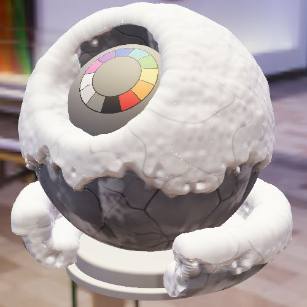
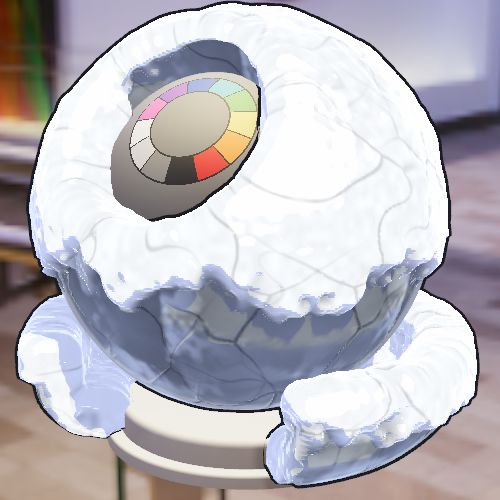
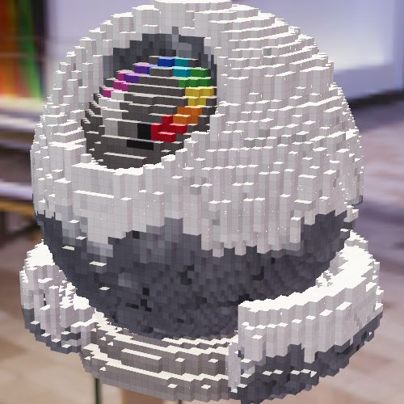
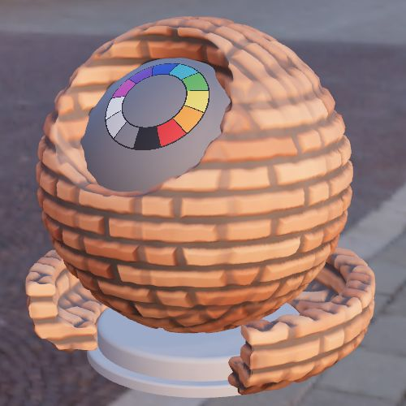
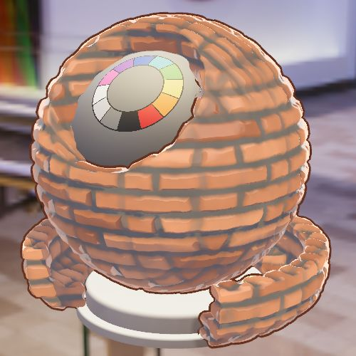
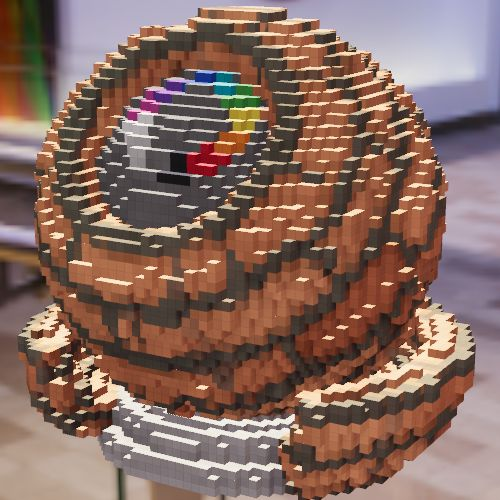
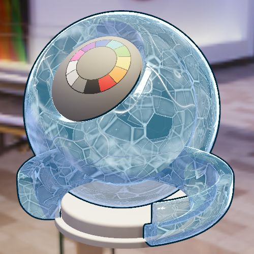
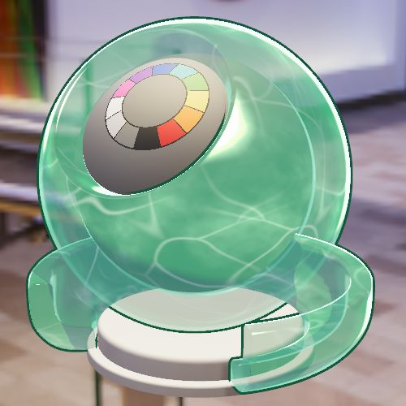
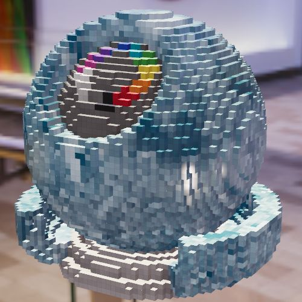
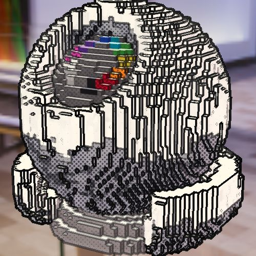

<div align="center">

# ✦ ShaderMaker ✦

**一个材质，三个世界。**
写实 PBR · 卡通 NPR · Teardown 式体素——同一份程序材质，一键切换，积雪、置换、次表面散射全程跟随。


<br>

| 写实 PBR | 卡通 NPR | 体素 Voxel |
|:---:|:---:|:---:|
|  |  |  |
|  |  |  |

<sub>上：雪地，积雪真的鼓出来，卡通模式的描边跟着雪堆走，体素模式的雪一格一格往上堆。<br>下：风格化红砖，置换让砖块凸出来，阴影跟着形状变，体素里的砖块整格凸出。</sub>

</div>

---

## ⚡ 30 秒上手

```bash
python3 serve.py          # → http://127.0.0.1:5173（禁用缓存，改完刷新即生效）
```

然后在底部输入框直接说：

```
换成科幻面板          改成锈铁，二次元          赛璐璐，描边粗一点
厚涂，暖色阴影        像素风                    teardown，体素更粗
```

解析在浏览器本地完成，不依赖后端。Three.js `r170` 走 unpkg CDN，仓库不托管 `vendor/`。

> 🧩 也可以装成 **Cindy 插件**，让对话里的 AI 直接替你调材质、截图检查，见 [Cindy 插件](#-cindy-插件)。

---

## 🌌 效果 × 渲染模式：全矩阵支持

1.5.0 起，所有材质效果在三种渲染模式下都能用，并且形状处处一致：模型、描边、阴影、滤镜遮罩、通道查看都按同一套顶点外推走。

| 效果 | 写实 PBR | 卡通 NPR | 体素 |
|---|:---:|:---:|:---:|
| 三向投影（无接缝贴图） | ✅ | ✅ | ✅ 每块一个颜色 |
| **高度置换** | ✅ 曲面细分后真实位移 | ✅ 描边同步外推 | ✅ 方块沿表面整格拉长 |
| **积雪** | ✅ 雪堆鼓起 + 雪面凹凸 + 冰晶闪烁 | ✅ 雪走卡通高光 | ✅ 整块变白，朝上的面往上堆 |
| **次表面散射** | ✅ 背光透亮 + 边缘发光 | ✅ 分阶透光色带 | ✅ |
| **冰下碎冰** | ✅ 视差层，转视角有纵深 | ✅ | ✅ 按块取色 |
| 动态阴影 | ✅ 跟随置换 | ✅ | ✅ 跟随拉长的方块 |
| 画面滤镜（勾线类） | ✅ | ✅ | ✅ |

<div align="center">

| 卡通 · 冰面 | 卡通 · 翡翠（SSS） | 体素 · 冰面 | 体素 · 漫画滤镜 |
|:---:|:---:|:---:|:---:|
|  |  |  |  |

</div>

---

## 🎨 材质库

### PBR · 26 个
按 **校准 / 金属 / 介质 / 涂层 / 织物 / 透明体 / 光学** 分类：常见金属、塑料、橡胶、陶瓷、车漆、丝绒、玻璃、水、钻石、虹彩薄膜。参数覆盖 `MeshPhysicalMaterial` 的全部能力：金属度、粗糙度、镜面、IOR、清漆、Sheen、各向异性、虹彩、透射、体积吸收、色散。

### Shader · 58 个程序纹理
带实时缩略图卡片，Pro 模式可按类别筛选（`src/presets.js` 的 `shaderCategories`）：

| 类别 | 内容 |
|---|---|
| 💎 **宝石 · 冰晶** | 冰面、钻石切面、水晶、祖母绿、琥珀、翡翠、晶簇 |
| ⚙️ **金属** | 划痕拉丝、掉漆金属、大马士革钢、铜绿、液态金属、锈铁、锤纹金属 |
| 🧱 **石材 · 陶瓷** | 风格化红砖、石灰岩砖、苔藓石墙、剥落墙面、马赛克、木模混凝土、清水混凝土、抛光花岗岩、水磨石、大理石、岩石、釉面瓷砖、金缮 |
| 🏔️ **自然** | 沙丘、雪地、车辙雪地、老树皮、岩浆、龟裂熔岩、海洋、木纹 |
| 🐉 **有机 · 织物** | 荔枝纹皮革、丝织、龙鳞、生物荧光 |
| 🛸 **科幻** | 科幻面板、六角装甲、电路板、碳纤维、镭射膜 |
| ✨ **VFX** · 14 | 极光、等离子、星空、火焰、霓虹、焦散、全息、传送门、数字雨、细胞、星云、能量护盾、等离子网、电弧 |

- **速度统一**：速度 1 = 每个效果的自然节奏。动态效果默认 1，静态写实材质默认 0，快慢集中在 `src/shaders.js` 末尾的 `timeScales`。
- **VFX 底色自动压暗**，靠自发光出效果，不会被环境光照成一片灰。
- **随机变体**：整体旋转色相、换噪声种子，快速找配色。
- 默认打开的是 **雪地**，一进来就能看到曲面细分 + 积雪置换。Lookdev 色卡球在「校准」里。

---

## 🔬 材质效果（`src/materialFx.js`）

<details open>
<summary><b>高度置换 · 曲面细分</b></summary>

- Surface Shader 把高度写进 ORM 贴图的 alpha 通道，顶点着色器按三向投影读出来，真的把表面推出去：砖缝凹进去、石头鼓起来。由「置换高度」滑条控制。
- 展示模型加载时做均匀细分（`src/models.js` 的 `densify`）。共享边只取一个中点，所以置换不会裂缝。
- 沿**平均法线**（`outlineNormal`）外推，UV 接缝处的重复顶点推得一样远。
- **NPR**：描边外壳读同一张高度图一起外推，雪堆和砖块不会把描边吞掉。
- **体素**：方块沿表面朝向最接近的坐标轴整格拉长，只往外长、不往里缩，壳不会破洞。拉长后的面仍按格子压暗边缘，看起来还是一格一格。
</details>

<details>
<summary><b>积雪</b></summary>

- 朝上的面盖雪，雪线用噪声打散，任何材质都能叠。
- 雪沿平均法线真的鼓起来，「积雪厚度」控制高度；雪面另有凹凸，雪里的冰晶随时间闪烁。
- **NPR**：雪的粗糙度和金属度写进卡通高光参数，雪面不会带金属反光。
- **体素**：按块中心判断，整块变白；朝上的块按雪的厚度往上多长几格，侧面只变白不长高。
</details>

<details>
<summary><b>次表面散射（SSS）</b></summary>

- 近似光线透进材质再散出来：背光处透亮，边缘发光。加在自发光上，所以透射高的冰和宝石也不会把它混掉。
- 用在冰、翡翠、琥珀、大理石、磨砂玻璃、珍珠、雪上。
- **NPR**：改成分阶画法，背光处一条透亮色带加边缘一圈，色带软硬跟着「交界软硬」走。
</details>

<details>
<summary><b>冰下碎冰</b></summary>

- 视差层：表面下几个深度各画一层缓慢漂移的碎冰板，带白色压力脊和气泡，越深越暗越蓝，转动视角能看出纵深。
- **体素**：每块取块中心看进去的颜色，整块一个色，冰面仍有深浅层次。
</details>

<details>
<summary><b>三向投影 · 可平铺</b></summary>

- 程序贴图在展示空间从 X / Y / Z 三个方向投影，再按法线混合，不走模型 UV，所以 UV 岛之间、球体接缝处都不会裂开（`src/triplanar.js`）。
- 贴图每帧额外做一次可平铺处理，投影重复处也没有接缝。
</details>

---

## 🖌️ 渲染模式

### 写实 PBR
- 直射光来自 Key / Fill 方向光、Rim 点光和半球光，Key Light 开启阴影。
- HDR 经 PMREM 写入 `scene.environment`，提供 IBL 间接漫反射和镜面反射（不是动态多次反弹 GI）。
- Surface Shader 分别输出 Base Color、AO / Roughness / Metalness、Normal、Emissive，法线由各材质自己的高度函数生成。

### 卡通 NPR · 赛璐璐 / 二次元 / 厚涂
NPR 不是滤镜，而是给 `MeshToonMaterial` 打补丁、换掉光照模型。灯光（含阴影）只累计受光量，再统一分阶、上阴影色。两种模式共用同一份材质数据，只换光照。

| PBR 属性 | → NPR 表现 |
|---|---|
| 金属度 | 天空 / 地平线 / 地面三段分阶反射，代替 HDR 反射 |
| 粗糙度 | 硬高光的大小和强度 |
| 清漆 | 额外的硬白高光点 |
| Sheen | 边缘光，颜色取 Sheen 颜色 |
| 透射 | 半透明 + 加强边缘光，偏向吸收色 |
| 虹彩 / 色散 | 彩虹色边缘光 |
| 次表面散射 | 分阶透光色带 |
| 积雪 | 雪色 + 雪的卡通高光 |

- Surface Shader 逐像素读取 ORM，同一块材质上的锈和金属分别处理。
- 明暗由主光决定：着色器按方向认出主光，补光和点光只给 25% 权重，不改场景灯光本身。
- **作用于：仅模型 / 全局**。仅模型时保留 ACES 色调映射，NPR 材质输出 ACES 反函数抵消；全局时背景换平涂色并关闭 ACES。
- 描边是沿平均法线外扩的背面外壳，主体用模板缓冲，玻璃主体也不会透出外壳。
- 暂不支持：各向异性高光的拉伸形状、体积吸收的厚度变化。

### 体素 Voxel · Teardown 式
- 右侧面板开关 + 精细度滑条（12–96，即模型高度方向的体素数）。把展示模型转成表面体素，用实例化网格渲染。
- 每块记住它在原模型上的 UV 和表面朝向，材质贴图按这个点取色，一块一个颜色，动画 Shader 照样会动。
- 体素 AO：按 26 邻域被占用的格数压暗，角落和缝隙更暗；另有逐块亮度抖动和方块边缘压暗。
- 拖动滑条实时重算，最近 8 个精细度会缓存。Shader Ball 精细度 72 约 4 万块，生成约 70 ms。
- 体素化用细分前的网格采样，结果一样、快很多。
- 暂不支持：体素在卡通模式下的描边外框。

### 画面滤镜
像素 / 漫画 / 油画 / 素描 / 赛博 / 胶片 / 蓝图。
NPR 是材质 Shader，着色时就知道法线、光源和阴影；滤镜是相机后处理，只拿到渲染好的 2D 像素。两者可以叠加。勾线类滤镜的法线深度图支持体素和置换。

---

## 🖥️ 界面

沉浸式画布：模型占满画面，材质库（左）和外观设置（右）是浮在上面的毛玻璃面板；窄屏和 Cindy 侧栏里面板会依次排到画面下方。右上角切换 **Lite / Pro**（记在本机）：

- **Lite**：材质库、写实 / 卡通、展示模型、环境、滤镜、体素，每种材质只留 3 个常用滑条（卡通再加阴影亮度和描边粗细）。
- **Pro**：全部参数（按基础 / 表层 / 体积分组）、材质分类筛选、滤镜强度、作用范围、通道检查。
- 两种模式共用同一份材质和设置，切换不丢状态。哪些滑条属于 Lite 由 `src/presets.js` / `src/npr.js` 里的 `lite: true` 决定。

**展示**参照 MaterialX Viewer：模型悬浮在清晰的 HDR 环境前（摄影棚 / 日落 / 夜景 / 户外广场），不放地面和台座，不自动旋转，拖动画面查看。

- **Shader Ball**（默认）：外壳挂当前材质；内芯色环和灰底盘是校色参照，任何模式下都保持写实。
- **球 / 方块**（圆角）：和 Shader Ball 共用同一个取景框。
- **通道查看**：把 Base / AO / 粗糙 / 金属 / 法线 / 自发光单独贴到主体上检查，形状和最终画面一致。

---

## 🧩 Cindy 插件

左侧导航多一个 ShaderMaker 入口（整页打开，也可以拖进侧栏或弹成独立窗口），对话里的 AI 能直接调整页面。

```bash
npm install
npm run build:plugin      # → dist/cindy-plugin/
```

然后用 Cindy 的 `ghost_forge_pack` 打包 `dist/cindy-plugin/`，得到 `shadermaker-<版本>.cindy`，导入即可。

| AI 工具 | 作用 |
|---|---|
| `set_look` | 精确设置材质、PBR / NPR、NPR 预设、滤镜与强度、作用范围、环境、展示模型、体素与精细度、材质参数、三色、NPR 参数，返回完整状态 |
| `describe_look` | 一句话调整，等同于页面输入框（复用 `src/nl.js`） |
| `snapshot` | 截取当前画面给 AI 看，方便它边调边检查 |

- 没有打开的 ShaderMaker 页面时，会自动在当前任务的右侧栏打开任务页（首次加载约 2 秒）。
- 同一份页面有两个入口：主视图（`mainView`）和任务页（`taskView`）。可能同时开着好几份，后台按「当前任务的任务页 → 主视图 → 其它」选一份执行，不会重复执行。
- **打包时的改动**（插件页面 CSP 只允许包内脚本，且不能联网）：
  - esbuild 把 `src/` 与 three.js 打成一个 `app.js`，替代 importmap（内联脚本会被 CSP 拦截）。
  - HDR 打进包里。整包限 8 MB，所以插件版用 1k HDR（缓存在 `.cache/hdr/`），网页版仍用 2k。
  - `ghost.json` 由 `cindy-plugin/manifest.mjs` 生成，工具参数的可选项读自现有数据，新增材质、滤镜、环境不用改插件代码。

---

## 🗂️ 代码结构

```
src/
├── app.js           场景与界面；末尾导出给 Cindy 插件的 shaderMaker 控制接口
├── shaders.js       GLSL：公共噪声 / Voronoi、Surface 协议、58 个 Shader、timeScales
├── presets.js       PBR 材质库、Shader 预设、分类、滑条定义
├── materialFx.js    置换、积雪、SSS、冰下碎冰（PBR / NPR / 体素 + 描边 / 阴影 / 滤镜共用的顶点外推）
├── triplanar.js     三向投影、可平铺处理
├── npr.js           NPR 光照模型、描边、PBR → NPR 转换规则
├── voxel.js         体素化：表面采样、体素 AO、实例化网格、材质体素补丁
├── stylize.js       画面滤镜后处理管线
├── models.js        展示模型（Shader Ball / 球 / 方块）、曲面细分、校色件
├── environments.js  HDR 环境
├── nl.js            自然语言解析
└── vendor/          tileable-shaders（MIT）
cindy-plugin/        page.js（页面入口）· main.js（插件后台）· manifest.mjs · build.mjs
```

---

## 📜 版本

每个版本的变化见 **[CHANGELOG.md](CHANGELOG.md)**。仓库在 [github.com/rozen630/ShaderMaker](https://github.com/rozen630/ShaderMaker)，默认分支 `main`，每个插件版本对应一个 `vX.Y.Z` 标签。

## 🙏 第三方资源

- `assets/models/materialx-shaderball.glb`：MaterialX Viewer 的默认 Shader Ball，来自 [AcademySoftwareFoundation/MaterialX](https://github.com/AcademySoftwareFoundation/MaterialX/tree/main/resources/Geometry)，Apache License 2.0，授权原文见 `assets/models/MATERIALX-LICENSE.txt`。内芯色环由 ShaderMaker 程序生成，不是原始资源的一部分。
- `src/vendor/tileable-shaders.js`：[tuxalin/procedural-tileable-shaders](https://github.com/tuxalin/procedural-tileable-shaders)（MIT，授权原文见 `src/vendor/TILEABLE-SHADERS-LICENSE.txt`）。新版 Shader 用到其中的可平铺噪声、Voronoi、裂纹、六边形、编织、Domain Warping。原库有几处类型错误编译不过，做了最小修补，改动处标了「ShaderMaker」。
- HDR 环境：[Poly Haven](https://polyhaven.com/hdris)（CC0）。网页版运行时从 Poly Haven CDN 加载 2k 版本，Cindy 插件版把 1k 版本打进包里。
